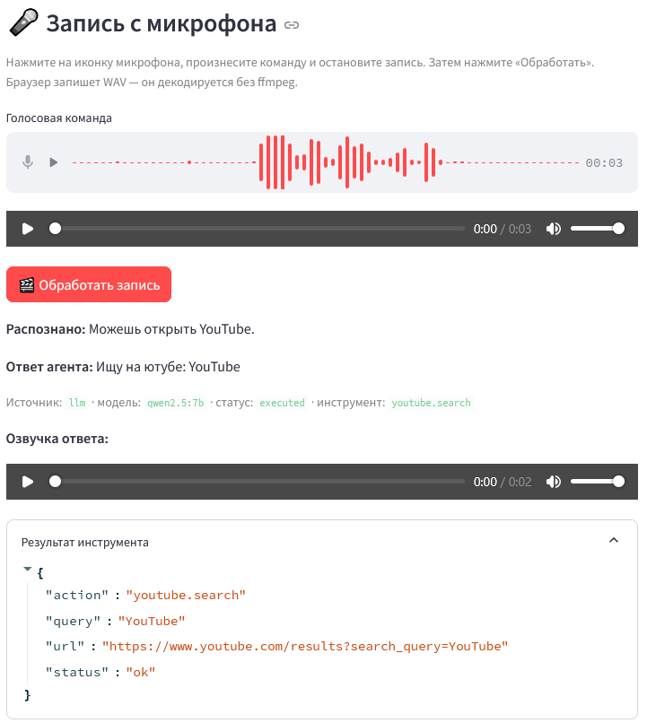
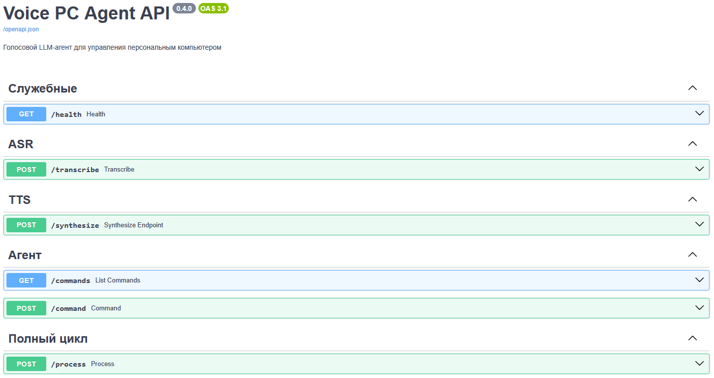
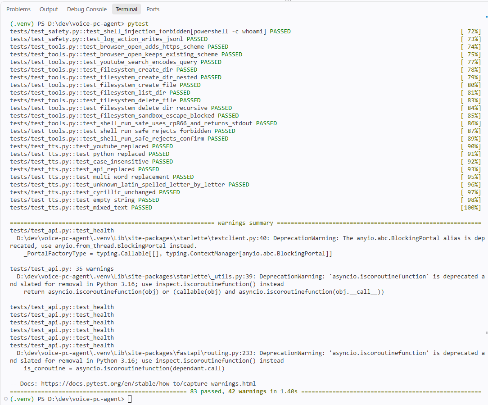
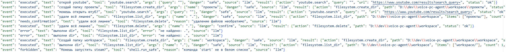

# 🎙️ Голосовой LLM-агент для управления ПК

Голосовой ассистент для персонального компьютера с механизмами безопасного
выполнения команд. Пользователь говорит в микрофон — система распознаёт речь,
понимает команду через локальную LLM, выполняет действие на компьютере
и отвечает голосом.

**Магистерская диссертация + проектный практикум**  
Направление 09.04.01 «Информатика и вычислительная техника»

**Тема:** «Разработка голосового LLM-агента для управления персональным
компьютером с механизмами безопасного выполнения команд».

---

## ✨ Возможности

- **Полный голосовой цикл:** микрофон → распознавание речи → выполнение → озвучка ответа.
- **Локальный LLM-планировщик** через Ollama (`qwen2.5:7b`) с tool calling.
- **Regex-fallback** — система работает даже без LLM (гарантированная деградация).
- **Три уровня опасности** команд: `SAFE` / `CONFIRM` / `FORBIDDEN`.
- **Sandbox** для файловых операций — всё только внутри `workspace/`.
- **Белый список** shell-команд + защита от инъекций.
- **Подтверждение** опасных операций (удаление файлов).
- **Журнал всех действий** (`action_log.jsonl`).
- **83 автотеста** (модульные + интеграционные для API с моками моделей).

---

## 📸 Демонстрация

### Полный голосовой цикл



### Swagger UI — все эндпоинты



### Тесты



### Журнал действий (`action_log.jsonl`)



### Видео-демонстрация

[▶ demo.mp4](screenshots/demo.mp4)

---

## 🏗️ Архитектура

```
[Браузер: Streamlit UI]
   │  микрофон (st.audio_input) / загрузка файла
   ▼
[Streamlit :8501]  app.py
   │  HTTP
   ▼
[FastAPI :8000]  api.py
   │
   ├─→ ASR: Whisper (faster-whisper, локально)
   │       аудио → текст
   │
   ├─→ Планировщик: agent.py
   │       ├─ plan_llm() — Ollama (qwen2.5:7b), tool calling
   │       └─ plan()     — regex-fallback
   │       → Plan { tool, args, danger, reason, description }
   │
   ├─→ Безопасность: safety.py
   │       проверка danger, sandbox, whitelist shell
   │
   ├─→ Исполнение: tools.py
   │       browser.open, youtube.search, filesystem.*, shell.run_safe
   │
   └─→ TTS: Silero v5_ru (голос baya, локально)
           текст ответа → WAV
   │
   ▼
[Streamlit]  показывает текст, проигрывает аудио, результат инструмента
```

**Ollama** — локальный сервис, слушает `localhost:11434`. Модель `qwen2.5:7b`
загружается в память при первом запросе.

---

## 🔌 Эндпоинты API

| Метод | Путь | Назначение |
|---|---|---|
| `GET`  | `/health`     | Статус сервиса + флаг `tts_loaded` |
| `POST` | `/transcribe` | Аудиофайл → распознанный текст |
| `POST` | `/synthesize` | Текст → base64-WAV (голос `baya`) |
| `GET`  | `/commands`   | Список поддерживаемых правил |
| `POST` | `/command`    | Текстовая команда → план + выполнение |
| `POST` | `/process`    | **Полный цикл:** аудио → текст + ответ + озвучка |

Интерактивная документация (Swagger UI): http://127.0.0.1:8000/docs

---

## 🧰 Поддерживаемые инструменты (скиллы)

| Инструмент | Действие | Опасность |
|---|---|---|
| `browser.open(url)` | Открыть URL в браузере | `SAFE` |
| `youtube.search(query)` | Поиск на YouTube | `SAFE` |
| `filesystem.create_dir(name)` | Создать папку в sandbox | `SAFE` |
| `filesystem.create_file(name, content)` | Создать файл в sandbox | `SAFE` |
| `filesystem.list_dir(name)` | Список содержимого папки | `SAFE` |
| `filesystem.delete(name)` | Удалить файл/папку | `CONFIRM` |
| `shell.run_safe(command)` | Shell из белого списка | `SAFE` / `CONFIRM` / `FORBIDDEN` |

Все файловые операции — только внутри `workspace/` в корне проекта.
Попытка выйти за пределы (`../`) блокируется в `safety.resolve_in_workspace`.

---

## 🔐 Механизмы безопасности

Реализованы в `safety.py` — **единая точка контроля**, независимая от LLM.
LLM не может обойти политику безопасности: она лишь предлагает план,
а `safety.py` решает, можно ли его выполнять.

1. **Три уровня опасности:**
   - `SAFE` — выполняется молча (открыть браузер, создать папку).
   - `CONFIRM` — требует явного подтверждения пользователя (удаление файлов).
   - `FORBIDDEN` — отклоняется всегда (shutdown, rm -rf, инъекции).

2. **Sandbox для файловых операций:**
   `resolve_in_workspace()` приводит путь к абсолютному и проверяет,
   что результат внутри `workspace/`. Работает через `.resolve()`, поэтому
   закрывает `..`, симлинки и абсолютные пути снаружи.

3. **Белый список shell-команд:**
   Разрешены только `dir, ls, pwd, whoami, date, time, hostname, ver, echo`.
   Всё остальное — `FORBIDDEN`. Дополнительно — чёрный список подстрок
   (`rm `, `shutdown`, `powershell`, `|`, `&&`, `;`, `>`, обратная кавычка,
   `$(`, `..\`, `../` и др.) как defense in depth.

4. **Журнал действий:** все события (`executed`, `forbidden`,
   `needs_confirmation`, `unrecognized`, `error`) пишутся в
   `action_log.jsonl` с timestamp, текстом команды, инструментом,
   аргументами, уровнем опасности, источником (`llm`/`regex`) и результатом.

---

## 💻 Требования

- **Windows 10/11** (разработано и протестировано).
- **Python 3.11–3.13.**
- **Ollama** — для LLM-планировщика ([ollama.com/download](https://ollama.com/download)).
- **~10 ГБ свободного места** на диске: ~4.7 ГБ модель LLM, ~0.5 ГБ Whisper, ~2 ГБ torch, ~50 МБ Silero TTS.
- **8+ ГБ ОЗУ** (рекомендуется 16 ГБ для комфортной работы LLM).

> Если ОЗУ/VRAM мало — используйте модель `qwen2.5:3b` (~2 ГБ) вместо `qwen2.5:7b`
> и/или уменьшите Whisper до `base` через переменную окружения.

---

## 🚀 Установка

### 1. Клонирование и виртуальное окружение

```powershell
git clone https://github.com/<ваш-логин>/voice-pc-agent.git
cd voice-pc-agent

python -m venv .venv
.venv\Scripts\Activate.ps1
# Если PowerShell блокирует: Set-ExecutionPolicy -Scope Process -ExecutionPolicy Bypass

python -m pip install --upgrade pip
pip install -r requirements.txt
```

### 2. Установка Ollama и модели

1. Скачайте и установите **Ollama**: https://ollama.com/download/windows
2. После установки Ollama работает в фоне (иконка в трее).
3. Скачайте модель (один раз, ~4.7 ГБ):

   ```powershell
   ollama pull qwen2.5:7b
   ```

4. Проверьте, что модель видна:

   ```powershell
   ollama list
   ```

> **Альтернативная модель (русскоязычная):** `ollama pull t-tech/T-lite-it-2.1`
> — можно выбрать в Streamlit-сайдбаре.

### 3. Запуск бэкенда (Терминал 1)

```powershell
.venv\Scripts\Activate.ps1
python -m uvicorn api:app --host 127.0.0.1 --port 8000
```

Первый запуск долгий: скачивается Whisper `small` (~500 МБ), грузится
Silero TTS (~50 МБ), при первом m4a-запросе — `ffmpeg` (~80 МБ).

Ожидаемый лог:

```
[startup] Загружаю Whisper: small (device=cpu, compute=int8)
[startup] Whisper готов
[startup] Загружаю Silero TTS (voice=baya)...
[startup] Silero TTS готов
[startup] Sandbox: D:\dev\voice-pc-agent\workspace
INFO:     Application startup complete.
```

### 4. Запуск фронтенда (Терминал 2)

```powershell
.venv\Scripts\Activate.ps1
python -m streamlit run app.py
```

Откроется http://localhost:8501. Разрешите браузеру доступ к микрофону.

---

## 🎤 Как пользоваться

1. В блоке **«🎤 Запись с микрофона»** нажмите иконку микрофона.
2. Произнесите команду: *«можешь открыть ютуб?»*, *«создай папку отчёты»*,
   *«найди на ютубе python для начинающих»*.
3. Нажмите **«🎬 Обработать запись»**.
4. Через 10–30 секунд увидите:
   - распознанный текст;
   - ответ агента;
   - **озвучку ответа** (голос `baya`);
   - результат выполненного инструмента.

Опасные команды (например, *«удали отчёты»*) запросят подтверждение —
появится кнопка **«✅ Подтвердить и выполнить»**.

---

## 🧪 Тесты

```powershell
pytest
pytest --cov=. --cov-report=term-missing
```

83 теста, ~2 секунды. Покрывают:

- `safety.py` — уровни опасности, sandbox, whitelist, инъекции, лог;
- `agent.py` — regex-правила, приоритеты, execute;
- `tools.py` — инструменты (с моками `webbrowser` и `subprocess`);
- `tts.py` — `preprocess_text` (замены латиницы);
- `api.py` — все эндпоинты через `TestClient` с моками Whisper и TTS.

Тесты **не требуют** ни Ollama, ни torch-моделей, ни интернета —
все тяжёлые зависимости замоканы.

---

## 📁 Структура проекта

```
voice-pc-agent/
├── api.py              FastAPI-бэкенд (эндпоинты)
├── app.py              Streamlit-фронтенд
├── agent.py            Планировщик (regex + LLM через Ollama)
├── safety.py           Безопасность: уровни, sandbox, whitelist, лог
├── tools.py            Инструменты (браузер, файлы, shell)
├── tts.py              Silero TTS + preprocess_text
├── requirements.txt
├── pytest.ini
├── README.md
├── workspace/          Sandbox (создаётся автоматически)
├── action_log.jsonl    Журнал действий (создаётся автоматически)
└── tests/
    ├── conftest.py     Фикстуры (tmp_workspace, client_with_mocks, ...)
    ├── test_safety.py
    ├── test_agent.py
    ├── test_tools.py
    ├── test_tts.py
    └── test_api.py
```

---

## ⚙️ Переменные окружения (опционально)

| Переменная | По умолчанию | Описание |
|---|---|---|
| `WHISPER_MODEL` | `small` | `tiny` / `base` / `small` / `medium` / `large-v3` |
| `WHISPER_DEVICE` | `cpu` | `cpu` или `cuda` (если есть NVIDIA GPU) |
| `WHISPER_COMPUTE_TYPE` | `int8` | `int8` / `float16` (GPU) / `float32` |
| `TTS_VOICE` | `baya` | Голос Silero: `aidar`, `baya`, `kseniya`, `xenia`, `eugene` |
| `API_URL` | `http://127.0.0.1:8000` | Адрес API для Streamlit |

Пример:

```powershell
$env:WHISPER_MODEL="medium"
$env:WHISPER_DEVICE="cuda"
python -m uvicorn api:app --host 127.0.0.1 --port 8000
```

---

## ⚠️ Известные ограничения

- **Интерфейс браузерный (Streamlit).** Направление развития — настольное
  приложение (PyQt6 / Flet / pywebview / Tauri).
- **`st.audio_input` работает только на `localhost` или HTTPS** —
  браузерное ограничение безопасности.
- **TTS на CPU** синтезирует ~5–20 секунд на короткую фразу. Можно
  переключить голос на `aidar` (быстрее) или модель на `v4_ru` (легче).
- **Whisper `small` на CPU** — 5–15 секунд на 5-секундную фразу.
- **Функционал инструментов ограничен** браузером, файлами и shell из
  белого списка. Нет управления окнами, клавиатурой, мышью, приложениями
  Windows — это следующие шаги развития.
- **m4a-декодирование:** первый вызов `static_ffmpeg.add_paths()` скачивает
  `ffmpeg` (~80 МБ), потом кэшируется.
- **Нет wake-word** («привет, ассистент») — активация только по кнопке.

---

## 🛣️ Направления развития

1. **Настольное приложение** с глобальным хоткеем и иконкой в трее.
2. **Расширение инструментов:** приложения (`app.launch`/`close`/`focus`),
   окна, клавиатура/мышь, медиа, питание — все через `safety.py`.
3. **Wake-word** (openWakeWord / Porcupine).
4. **Prompt engineering** и few-shot примеры для LLM под русские команды.
5. **Сравнительный анализ моделей** (Qwen 2.5 vs T-lite) для диссертации.
6. **RAG** по документации инструментов для больших наборов.

---

## 📜 Лицензия и авторство

Магистерский проект, 2025–2026. Код открыт для образовательных целей.